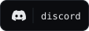
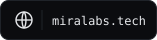

<!-- GitHub profile README: github.com/wewesss/wewesss, cards generated by github.com/wewesss/ghstats -->

<picture>
  <source media="(prefers-color-scheme: dark)" srcset="ghstats/identity-dark.svg">
  <source media="(prefers-color-scheme: light)" srcset="ghstats/identity-light.svg">
  
</picture>

<picture>
  <source media="(prefers-color-scheme: dark)" srcset="ghstats/stats-dark.svg">
  <source media="(prefers-color-scheme: light)" srcset="ghstats/stats-light.svg">
  
</picture>

<a href="https://www.youtube.com/@wewesss14"><picture><source media="(prefers-color-scheme: dark)" srcset="ghstats/links/youtube-dark.svg"><source media="(prefers-color-scheme: light)" srcset="ghstats/links/youtube-light.svg"></picture></a>
<a href="https://www.twitch.tv/wewesss14"><picture><source media="(prefers-color-scheme: dark)" srcset="ghstats/links/twitch-dark.svg"><source media="(prefers-color-scheme: light)" srcset="ghstats/links/twitch-light.svg"></picture></a>
<a href="https://discord.com/invite/B6Z5VbA5wd"><picture><source media="(prefers-color-scheme: dark)" srcset="ghstats/links/discord-dark.svg"><source media="(prefers-color-scheme: light)" srcset="ghstats/links/discord-light.svg"></picture></a>
<!-- <a href="https://miralabs.tech"><picture><source media="(prefers-color-scheme: dark)" srcset="ghstats/links/website-dark.svg"><source media="(prefers-color-scheme: light)" srcset="ghstats/links/website-light.svg"></picture></a> -->
<a href="https://github.com/sponsors/wewesss"><picture><source media="(prefers-color-scheme: dark)" srcset="ghstats/links/github_sponsors-dark.svg"><source media="(prefers-color-scheme: light)" srcset="ghstats/links/github_sponsors-light.svg"></picture></a>

