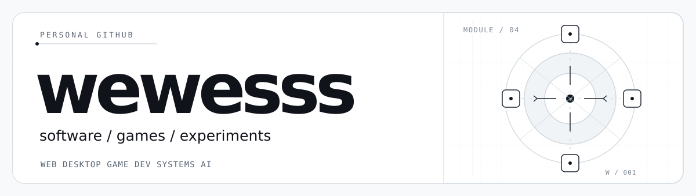

<!-- GitHub profile README: github.com/wewesss/wewesss -->

  <picture>
    <source media="(prefers-color-scheme: dark)" srcset="./assets/hero-dark.svg">
    <source media="(prefers-color-scheme: light)" srcset="./assets/hero-light.svg">
    
  </picture>

  Mostly building stuff. Web apps, games, tools, low-level experiments. 
  No fixed stack. It depends on what I'm making.

### Stuff I work on

<table>
  <tr>
    <td width="50%" valign="top">
      <strong>01 / Web &amp; desktop</strong> 
      Full-stack apps, APIs, interfaces, desktop software.
    </td>
    <td width="50%" valign="top">
      <strong>02 / Games</strong> 
      Gameplay systems, networking, engines, tools.
    </td>
  </tr>
  <tr>
    <td width="50%" valign="top">
      <strong>03 / AI &amp; automation</strong> 
      Coding agents, custom harnesses, automated workflows.
    </td>
    <td width="50%" valign="top">
      <strong>04 / Systems</strong> 
      Runtimes, compilers, libraries, native tooling.
    </td>
  </tr>
</table>

### Stats

  <picture>
    <source media="(prefers-color-scheme: dark)" srcset="./ghstats/stats-dark.svg">
    <source media="(prefers-color-scheme: light)" srcset="./ghstats/stats-light.svg">
    
  </picture>

  <a href="https://miralabs.tech">miralabs.tech</a>
  &nbsp;&nbsp;·&nbsp;&nbsp;
  <a href="https://github.com/wewesss?tab=repositories">repositories</a>

